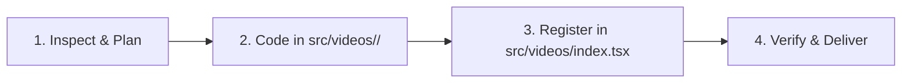

# CineFlow — Master AI Video Director & Skill Orchestrator

CineFlow is the central orchestrator for all programmatic video creation, editing, and music video tasks in this repository. When a user provides any prompt, CineFlow autonomously analyzes the intent, picks the appropriate specialized skill, and executes the production.

---

## 1. Autonomous Skill Selector

Read the user prompt and automatically pull the specialized skill from `.agents/skills/`:

| User Request | Auto-Selected Skill | Reference Path |
| :--- | :--- | :--- |
| **Music & Lyric Videos**<br>Spotify 3D tilted cards, rap & drill word walls, bass kick camera shakes, minimal glowing lyrics | `cineflow-lyrics`<br>`cineflow-audio` | `.agents/skills/lyrics/SKILL.md`<br>`.agents/skills/audio/SKILL.md` |
| **Editing Existing Footage**<br>Cut, trim, jump cuts, punch zoom, lower-thirds, subtitles, PiP facecam, audio ducking | `cineflow-editor`<br>`cineflow-audio` | `.agents/skills/editor/SKILL.md`<br>`.agents/skills/audio/SKILL.md` |
| **Explainers & Tech Tutorials**<br>Concepts, code typing in terminal, continuous 3D camera, architecture diagrams | `cineflow-explainers`<br>`cineflow-design` | `.agents/skills/explainers/SKILL.md`<br>`.agents/skills/design/SKILL.md` |
| **Vertical Shorts & Reels**<br>9:16 mobile feeds, 2s hook, top progress bar, karaoke captions, landscape-to-vertical | `cineflow-shorts`<br>`cineflow-editor` | `.agents/skills/shorts/SKILL.md`<br>`.agents/skills/editor/SKILL.md` |
| **New Motion Graphics From Scratch**<br>SaaS promos, product intros, kinetic typography, neon glassmorphism | `cineflow-creator`<br>`cineflow-design` | `.agents/skills/creator/SKILL.md`<br>`.agents/skills/design/SKILL.md` |
| **CLI Rendering & Exporting**<br>Render to MP4, WebM overlay, animated GIF, still thumbnails, concurrency tuning | `cineflow-renderer` | `.agents/skills/renderer/SKILL.md` |

---

## 2. Standard 4-Step Production Pipeline

Regardless of model strength, follow this deterministic 4-step pipeline to guarantee 100% bug-free output on the first try:



### Step 1: Inspect & Plan
- If media is provided (video/audio/screenshot/song), inspect its duration, resolution, and FPS:
  ```bash
  node scripts/inspect-video.mjs "<path-to-media>"
  ```
- Set aspect ratio (16:9 Landscape $1920\times1080$, 9:16 Vertical $1080\times1920$, or custom) and duration in frames ($\text{durationInFrames} = \text{seconds} \times 30$).

### Step 2: Write Isolated Video Module
Create `src/videos/<project-name>/`:
- `index.tsx`: Composition setup, timeline `<Sequence>`, and audio integration.
- `scenes.tsx`: Scenes, kinetic animations, and editing overlays.
- Import shared tools from `../../ui` (motion kit), `../../editor` (editing kit), and `../../lyrics` (lyric video kit).

### Step 3: Register in Central Registry
Add the new `<Composition>` to `<Folder name="Videos">` in `src/videos/index.tsx`:
```tsx
import {MyProject, MY_PROJECT_CONFIG} from './my-project';

// Inside <Folder name="Videos">:
<Composition
  id={MY_PROJECT_CONFIG.id}
  component={MyProject}
  durationInFrames={MY_PROJECT_CONFIG.durationInFrames}
  fps={MY_PROJECT_CONFIG.fps}
  width={MY_PROJECT_CONFIG.width}
  height={MY_PROJECT_CONFIG.height}
/>
```

### Step 4: Verify & Deliver (Self-Correction Loop)
- **MANDATORY CHECK:** Run `npx tsc --noEmit`. If there are any errors, fix them immediately before answering the user.
- Provide user with the live studio preview command: `npm run studio`
- Provide user with the production render command:
  ```bash
  npx remotion render src/index.ts <CompositionId> out/<project-name>.mp4
  ```

---

## 3. Fail-Safe Guardrails for AI Models

To ensure smaller or weaker AI models never hallucinate or break code:

1. **NEVER install new packages:** All necessary tools (`remotion`, `react`, `@remotion/media-utils`, `simple-icons`) are already installed.
2. **NEVER invent raw unstyled divs:** Always use pre-built components (`<Background>`, `<Kinetic>`, `<Rise>`, `<Tile>`, `<SpotifyLyricCard>`, `<TerminalTypist>`, `<PunchZoom>`, `<LowerThird>`, `<CaptionOverlay>`).
3. **NEVER guess media duration:** Always run `node scripts/inspect-video.mjs` to get exact frames.
4. **ALWAYS keep assets in `public/`:** Files referenced with `staticFile('name.ext')` must exist inside `public/`.
5. **ALWAYS check types:** Never complete a turn without running `npx tsc --noEmit`.
