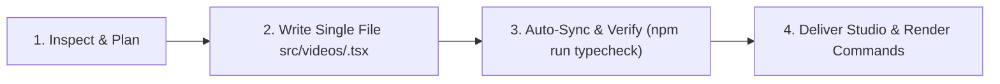

# CineFlow — Master AI Video Director & Skill Orchestrator

CineFlow is the central orchestrator for all programmatic video creation, editing, and music video tasks in this repository. When a user provides any prompt, CineFlow autonomously analyzes the intent, picks the appropriate specialized skill, and executes the production.

---

## 1. Autonomous Skill Selector

Read the user prompt and automatically pull the specialized skill from `.agents/skills/`:

| User Request | Auto-Selected Skill | Reference Path |
| :--- | :--- | :--- |
| **Music & Lyric Videos** Spotify 3D tilted cards, rap & drill word walls, bass kick camera shakes, lo-fi vinyl, synthwave neon | `cineflow-lyrics` `cineflow-audio` | `.agents/skills/lyrics/SKILL.md` `.agents/skills/audio/SKILL.md` |
| **Editing Existing Footage** Cut, trim, jump cuts, punch zoom, lower-thirds, subtitles, PiP facecam, audio ducking | `cineflow-editor` `cineflow-audio` | `.agents/skills/editor/SKILL.md` `.agents/skills/audio/SKILL.md` |
| **Explainers & Tech Tutorials** Concepts, code typing in terminal, continuous 3D camera, architecture diagrams | `cineflow-explainers` `cineflow-design` | `.agents/skills/explainers/SKILL.md` `.agents/skills/design/SKILL.md` |
| **Vertical Shorts & Reels** 9:16 mobile feeds, 2s hook, top progress bar, karaoke captions, landscape-to-vertical | `cineflow-shorts` `cineflow-editor` | `.agents/skills/shorts/SKILL.md` `.agents/skills/editor/SKILL.md` |
| **New Motion Graphics From Scratch** SaaS promos, product intros, kinetic typography, neon glassmorphism | `cineflow-creator` `cineflow-design` | `.agents/skills/creator/SKILL.md` `.agents/skills/design/SKILL.md` |
| **CLI Rendering & Exporting** Render to MP4, WebM overlay, animated GIF, still thumbnails, concurrency tuning | `cineflow-renderer` | `.agents/skills/renderer/SKILL.md` |

---

## 2. Standard Production Pipeline: Single-File Isolation

Every video in CineFlow is completely self-contained in a single file under `src/videos/<video-name>.tsx`:

### Rule 1: Single-File Isolation
- When creating a video, write all scenes, dynamic scene-adaptive backgrounds, sound effects, and config inside `src/videos/<video-name>.tsx`.
- **DO NOT TOUCH `src/videos/index.tsx`:** CineFlow's auto-sync engine (`scripts/sync-videos.mjs`) automatically scans `src/videos/*.tsx` and maintains the registry.
- **Instant Deletion:** If a user deletes `src/videos/<video-name>.tsx`, that video is immediately erased from the system without leaving any broken references.

### Rule 2: Editing Existing Videos
- If the user asks to modify an existing video (e.g. "change scene 2 timing", "update text at 20s"), locate and edit ONLY `src/videos/<video-name>.tsx`. Never touch other files.

### Rule 3: Creating New Videos
- If the user provides a prompt for a different, separate video, create a brand-new file `src/videos/<new-video-name>.tsx`.

### Rule 4: Mandatory Sound Design & Scene-Adaptive Backgrounds
- Every video MUST include:
  1. An upbeat electronic soundtrack: `<Audio src={staticFile('sfx/beat.wav')} volume={0.35} />`.
  2. Sound effects on element entrances: `sfx/whoosh.wav`, `sfx/pop.wav`, `sfx/impact.wav`, `sfx/click.wav`, `sfx/chime.wav`.
  3. Unique, custom atmospheric background for each scene (never the exact same background repeated throughout).

### Rule 5: Verification
- Always run `npm run typecheck` (`npm run sync && npx tsc --noEmit`) before responding to the user.
