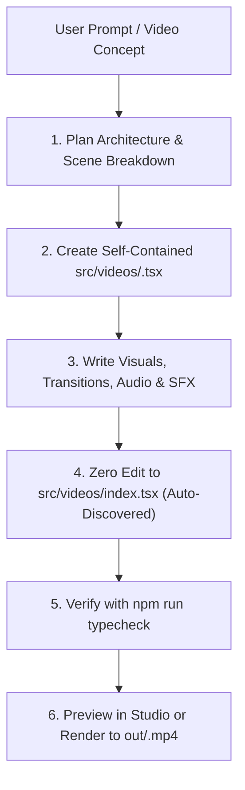

# CineFlow Video Creator (Prompt-to-Video Engine)

This skill enables an AI agent to autonomously transform any user idea, brief, or script into a fully animated, production-ready motion graphics video using React, TypeScript, and Remotion.

---

## 1. Core Workflow: From User Prompt to Video

When the user asks for a video (e.g., *"Make a 20-second promo video for my new AI app named NeuroTask"*):



---

## 2. Directory Structure & Zero-Touch Core Architecture

Every video created MUST live in its own self-contained file inside `src/videos/`. **NEVER edit core framework files (`src/ui.tsx`, `src/editor.tsx`, `src/lyrics.tsx`, `src/videos/index.tsx`)**—the repository uses dynamic Webpack discovery to mount videos automatically.

```text
├── user-project.json                 # ROOT USER MANIFEST (User branding, active project meta)
├── public/                           # USER MEDIA & SFX (MP3 songs, videos, cover art SVGs)
└── src/videos/
    ├── index.tsx                     # PERMANENT STATIC REGISTRY (Auto-discovers via Webpack - DO NOT EDIT)
    ├── EmptyPlaceholder.tsx          # Fallback / empty state
    ├── majaal-spotify-lyrics.tsx     # Self-contained video project 1
    └── <new-video-name>.tsx          # Your new isolated video project
```

---

## 3. Step-by-Step Implementation Guide

### Step 1: Analyze & Plan the Video Concept
From the user prompt, establish:
1. **Aspect Ratio & Resolution:**
   - Standard Landscape (YouTube/Web): $1920 \times 1080$ (16:9)
   - Vertical (Shorts/Reels/TikTok): $1080 \times 1920$ (9:16) — refer to `cineflow-shorts` (`.agents/skills/shorts/SKILL.md`)
   - Square (Social Feed): $1080 \times 1080$ (1:1)
2. **Duration & Frame Math:**
   - 30 FPS standard: $\text{durationInFrames} = \text{seconds} \times 30$
   - 10 seconds = 300 frames
   - 15 seconds = 450 frames
   - 30 seconds = 900 frames
   - 60 seconds = 1800 frames
3. **Scene Breakdown:**
   Divide duration into 3 to 6 distinct, engaging scenes with specific pacing:
   - *Scene 1: The Hook / Logo Reveal* (15% duration)
   - *Scene 2: Problem / Core Feature* (25% duration)
   - *Scene 3: Proof / Metrics / Showcase* (30% duration)
   - *Scene 4: Call to Action / Socials* (30% duration)

---

### Step 2: Implement Scene Components (`src/videos/<video-name>/scenes.tsx`)

Always utilize the shared motion toolkit from `../../ui`:
- `<Scene fadeIn={true} fadeOut={true}>`: Handles cinematic scale, blur, and opacity transitions between scenes.
- `<Kinetic text="..." delay={10} stagger={2} />`: High-energy letter-by-letter bouncy spring entrance.
- `<Rise delay={20} from="up"|"left"|"right"|"scale" dist={40}>`: Smooth slide, fade, and de-blur.
- `<Tile size={120} glow="...">`: Frosted glassmorphism container for icons and badges.
- `<Background />`: Dynamic glowing orbs, drift grid, and floating particle field.
- `spr(frame, fps, delay, config)`: Spring physics calculator (`POP` for bouncy, `SMOOTH` for fluid).
- `interpolate(frame, [inStart, inEnd], [valStart, valEnd], clamp)`: Frame-accurate value mapping.

**Example `scenes.tsx` Structure:**
```tsx
import React from 'react';
import {AbsoluteFill, interpolate, useCurrentFrame, useVideoConfig} from 'remotion';
import {C, clamp, gradientText, Kinetic, POP, Rise, Scene, spr, Tile} from '../../ui';

export const SceneHook: React.FC = () => {
  const f = useCurrentFrame();
  const {fps} = useVideoConfig();

  return (
    <Scene fadeIn={false}>
      <AbsoluteFill style={{alignItems: 'center', justifyContent: 'center'}}>
        <Kinetic
          text="NEXT-GEN WORKFLOW"
          delay={12}
          stagger={2}
          style={{fontSize: 96, fontWeight: 900, ...gradientText(C.lime, C.violetSoft)}}
        />
        <Rise delay={35} dist={30}>
          <p style={{fontSize: 36, color: C.dim, marginTop: 20}}>
            Supercharged with autonomous intelligence.
          </p>
        </Rise>
      </AbsoluteFill>
    </Scene>
  );
};
```

---

### Step 3: Implement Composition Root (`src/videos/<video-name>/index.tsx`)

Sequence the scenes with smooth transitions and overlap:

```tsx
import React from 'react';
import {AbsoluteFill, Sequence} from 'remotion';
import {Background, C, FONT} from '../../ui';
import {SceneHook, SceneFeature, SceneCTA} from './scenes';

export const MY_VIDEO_CONFIG = {
  id: 'NeuroTaskPromo',
  fps: 30,
  durationInFrames: 30 * 15, // 15 seconds
  width: 1920,
  height: 1080,
};

const T = 15; // 15 frames transition overlap

export const MyVideo: React.FC = () => {
  return (
    <AbsoluteFill style={{backgroundColor: C.bg, fontFamily: FONT, color: C.text}}>
      <Background />
      <Sequence from={0} durationInFrames={30 * 5 + T}>
        <SceneHook />
      </Sequence>
      <Sequence from={30 * 5} durationInFrames={30 * 5 + T}>
        <SceneFeature />
      </Sequence>
      <Sequence from={30 * 10} durationInFrames={30 * 5}>
        <SceneCTA />
      </Sequence>
    </AbsoluteFill>
  );
};
```

---

### Step 4: Automatic Discovery (NEVER touch `src/videos/index.tsx`)

`src/videos/index.tsx` dynamically discovers and registers all video compositions using native Webpack `require.context`. You do NOT need to write import statements or touch `src/videos/index.tsx` ever. Simply exporting `config` (or `MY_VIDEO_CONFIG`) and the component from `src/videos/<video-name>.tsx` makes it instantly available to Remotion!

---

### Step 5: Verify and Render

1. **Type Check:**
   ```bash
   npm run typecheck
   ```
2. **List Available Compositions:**
   ```bash
   npx remotion compositions src/index.ts
   ```
3. **Render to Video:**
   ```bash
   npx remotion render src/index.ts <CompositionId> out/<video-name>.mp4
   ```
