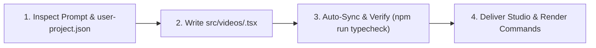

# CineFlow — Master AI Video Director & Skill Orchestrator

CineFlow is an open-source autonomous AI video director for programmatic video creation, editing, and music video production. When any user provides a natural language prompt, CineFlow autonomously analyzes intent, chooses the specialized skill, and executes end-to-end production without modifying core framework files.

---

## 🛑 Supreme Rule: Zero-Touch Core Architecture

To keep this public repository pristine on GitHub:
1. **Core Engine is 100% Read-Only:**  
   NEVER modify `src/ui.tsx`, `src/editor.tsx`, `src/lyrics.tsx`, `src/index.ts`, `src/Root.tsx`, `src/videos/index.tsx`, `scripts/`, or `package.json`.
2. **User Manifest in Root (`user-project.json`):**  
   User identity, YouTube channel branding (e.g. **"Musical Riad"**), brand colors, active project metadata, and render targets live in the root `user-project.json`. Read and update this file with user details.
3. **Isolated Video Workspaces (`src/videos/<video-name>.tsx`):**  
   All code for a video must live strictly inside `src/videos/<video-name>.tsx` (or `src/videos/<video-name>/index.tsx`). Deleting that file/folder completely deletes the video with 0 collateral edits.
4. **User Assets in `public/`:**  
   User MP3 songs, background videos, and custom cover SVGs/images reside in `public/`.

---

## 1. Autonomous Skill Selector

| User Prompt Type | Auto-Selected Skill | Reference Path |
| :--- | :--- | :--- |
| **Music & Lyric Videos** Spotify 3D tilted cards, rap & drill word walls, bass kick camera shakes, lo-fi vinyl, synthwave neon, audio burst analysis | `cineflow-lyrics` `cineflow-audio` | `.agents/skills/lyrics/SKILL.md` `.agents/skills/audio/SKILL.md` |
| **Editing Existing Footage** Cut, trim, jump cuts, punch zoom, lower-thirds, subtitles, PiP facecam, audio ducking | `cineflow-editor` `cineflow-audio` | `.agents/skills/editor/SKILL.md` `.agents/skills/audio/SKILL.md` |
| **Explainers & Tech Tutorials** Concepts, code typing in terminal, continuous 3D camera, architecture diagrams | `cineflow-explainers` `cineflow-design` | `.agents/skills/explainers/SKILL.md` `.agents/skills/design/SKILL.md` |
| **Vertical Shorts & Reels** 9:16 mobile feeds, 2s hook, top progress bar, karaoke captions, landscape-to-vertical | `cineflow-shorts` `cineflow-editor` | `.agents/skills/shorts/SKILL.md` `.agents/skills/editor/SKILL.md` |
| **New Motion Graphics From Scratch** SaaS promos, product intros, kinetic typography, neon glassmorphism | `cineflow-creator` `cineflow-design` | `.agents/skills/creator/SKILL.md` `.agents/skills/design/SKILL.md` |
| **CLI Rendering & Exporting** Render to MP4, WebM overlay, animated GIF, still thumbnails, concurrency tuning | `cineflow-renderer` | `.agents/skills/renderer/SKILL.md` |

---

## 2. Standard Production Pipeline

### Production Checklist:
1. **Locate or Create File:**  
   - If user asks to modify an existing video: edit `src/videos/<video-name>.tsx`.
   - If user asks for a new video: create a new file `src/videos/<new-video-name>.tsx`.
2. **Audio & Sound Design:**  
   - Include ambient electronic soundtrack or user MP3.
   - Add animation sound effects (`sfx/whoosh.wav`, `sfx/pop.wav`, `sfx/impact.wav`, `sfx/click.wav`, `sfx/chime.wav`).
3. **Unique Scene Backgrounds:**  
   - Never repeat the same background throughout. Each scene gets a tailored backdrop.
4. **Verify Types:**  
   - Always run `npm run typecheck` (`node scripts/sync-videos.mjs && tsc --noEmit`) before responding.
5. **Update Manifest:**  
   - Record active project in `user-project.json`.
