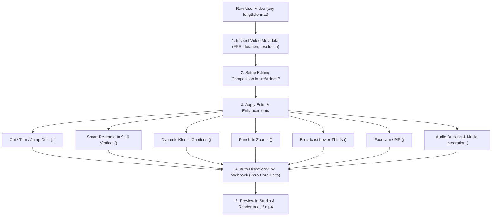

# CineFlow Video Editor (Post-Production Engine)

This skill enables an AI agent to edit any existing user-supplied video file—regardless of length, resolution, or format—using Remotion's programmatic editing pipeline.

---

## 1. Core Post-Production Capabilities



---

## 2. Zero-Touch Architecture & Workspace Isolation
1. **Never edit core files:** `src/editor.tsx`, `src/ui.tsx`, and `src/videos/index.tsx` are read-only.
2. **User Manifest:** Check and update `user-project.json` for active project metadata.
3. **Self-Contained File:** Write the editing composition strictly in `src/videos/<edit-name>.tsx`.

---

## 2. Step-by-Step Video Editing Workflow

### Step 1: Place Video & Inspect Metadata
1. The user places their video in the `public/` directory (e.g. `public/my-raw-video.mp4`).
2. Run the inspection script:
   ```bash
   node scripts/inspect-video.mjs "public/my-raw-video.mp4"
   ```
   This outputs the exact:
   - `durationSeconds`
   - `durationFramesAt30Fps`
   - `width` and `height`
   - `fps`
   - `aspectRatio` (16:9 Landscape or 9:16 Vertical)
   - `hasAudio`

---

### Step 2: Create Dedicated Edit Folder
Create `src/videos/<edit-name>/`:
- `src/videos/<edit-name>/index.tsx`: Main timeline, sequence, video clips, and overlays.
- `src/videos/<edit-name>/config.ts`: (Optional) Cut timestamps, captions data, lower-third details.

---

### Step 3: Implement Edits Using `src/editor.tsx`

Import editing primitives from `../../editor`:

```tsx
import {
  VideoClip,
  ReframeVertical,
  PunchZoom,
  PictureInPicture,
  LowerThird,
  CaptionOverlay,
  EditorProgressBar,
} from '../../editor';
```

#### Scenario A: Trimming, Multi-Clip Cuts & Jump Cuts
Use Remotion's `<Series>` for seamless multi-clip sequencing without manual frame calculations:

```tsx
import React from 'react';
import {Series} from 'remotion';
import {VideoClip} from '../../editor';

export const MultiClipEdit: React.FC = () => {
  return (
    <Series>
      {/* Clip 1: Keep seconds 0 to 5 (frames 0 to 150) */}
      <Series.Sequence durationInFrames={150}>
        <VideoClip src="my-raw-video.mp4" startFrom={0} endAt={150} />
      </Series.Sequence>

      {/* Clip 2: Jump cut to seconds 12 to 20 (frames 360 to 600) */}
      <Series.Sequence durationInFrames={240}>
        <VideoClip src="my-raw-video.mp4" startFrom={360} endAt={600} />
      </Series.Sequence>
    </Series>
  );
};
```

#### Scenario B: Convert 16:9 Landscape Video to 9:16 Vertical Short/Reel
Transform a wide screen recording or podcast into a viral vertical short:

```tsx
import React from 'react';
import {ReframeVertical, EditorProgressBar, LowerThird} from '../../editor';

export const EDIT_CONFIG = {
  id: 'PodcastReel',
  fps: 30,
  durationInFrames: 30 * 25, // 25 seconds
  width: 1080,
  height: 1920,
};

export const PodcastReel: React.FC = () => {
  return (
    <>
      <ReframeVertical
        src="podcast-raw.mp4"
        startFrom={30 * 10} // start at 10s
        endAt={30 * 35}     // end at 35s
        scale={1.05}
        borderRadius={32}
        blurAmount={30}
      />
      <EditorProgressBar position="top" color="#A3E635" />
      <LowerThird
        title="Alex Rivera"
        subtitle="Founder, AI Studio"
        delay={20}
        positionBottom={280} // Above mobile navigation safe zone
      />
    </>
  );
};
```

#### Scenario C: Punch-In Zoom (Camera Movement for Emphasis)
Punch in 1.25x on the speaker during an important statement:

```tsx
<PunchZoom fromZoom={1.0} toZoom={1.25} durationFrames={10} delay={90}>
  <VideoClip src="interview.mp4" />
</PunchZoom>
```

#### Scenario D: Animated High-Retention Subtitles / Captions
Display punchy word-by-word karaoke captions:

```tsx
const captions = [
  {startFrame: 0, endFrame: 60, text: "Stop writing boilerplate code today"},
  {startFrame: 60, endFrame: 120, text: "Let AI generate and edit everything"},
  {startFrame: 120, endFrame: 180, text: "Directly in your browser with Remotion"},
];

<CaptionOverlay segments={captions} activeColor="#A3E635" fontSize={64} />
```

#### Scenario E: Webcam Picture-in-Picture (PiP) Over Screen Recording
```tsx
<AbsoluteFill>
  {/* Fullscreen desktop screen recording */}
  <VideoClip src="screen-recording.mp4" />

  {/* Floating rounded webcam in bottom-right corner */}
  <PictureInPicture
    src="webcam.mp4"
    position="bottom-right"
    width={360}
    height={240}
    borderRadius={24}
    glowColor="#A3E635"
  />
</AbsoluteFill>
```

---

### Step 4: Register & Verify
1. Add the edited composition into `src/videos/index.tsx`.
2. Run type check:
   ```bash
   npx tsc --noEmit
   ```
3. Verify with `npx remotion compositions`.

---

### Step 5: Render Production Video
```bash
npx remotion render src/index.ts <EditCompositionId> out/<edit-output>.mp4
```
