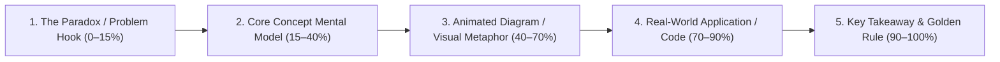

# CineFlow Explainer & Tutorial Creator

CineFlow provides a powerful technical storytelling engine to turn complex ideas, architecture diagrams, codebases, and tutorials into high-retention animated explainers.

---

## 1. The 5-Stage Explainer Storyboard Formula

High-retention explainer videos follow this proven narrative structure:



1. **The Hook (First 3-5 seconds):** Pose a striking question or counterintuitive fact using `<Kinetic />` typography.
2. **The Mental Model:** Introduce a simple real-world analogy (e.g. "Think of a cache as a desk drawer vs. a basement warehouse").
3. **The Animated Diagram:** Render connected nodes, moving arrows, and visual flowcharts using `<Tile>`, `<Card3D>`, and animated paths.
4. **The Code / Hands-On Proof:** Use `<TerminalTypist>` to type commands in an animated shell or show live metric counters.
5. **The Golden Takeaway:** Crystallize the core lesson in one bold, glowing sentence with a sound effect accent.

---

## 2. Explainer Components & Tools

Import directly from `../../editor` and `../../ui`:

| Component | Use Case |
| :--- | :--- |
| `<TerminalTypist>` | Animated macOS terminal typing out CLI commands or code snippets with live output. |
| `<Card3D>` | 3D perspective cards with gyroscope tilt for displaying architectural components or server blocks. |
| `<OneTakeCamera>` | Smooth, continuous virtual camera panning between topics without jarring jump cuts. |
| `<AudioWaveform>` | Pulsing audio visualizer bars indicating voice narration or sonic activity. |
| `<ScreenshotMockup>` | Framing documentation, dashboards, or web UI screenshots in a clean device frame. |
| `<KeywordCallout>` | Punchy emphasis cards that pop up when pivotal technical terms are introduced. |

---

## 3. Explainer Implementation Recipe

### Example: "How WebSockets Work (vs HTTP)"

```tsx
import React from 'react';
import {AbsoluteFill, Sequence} from 'remotion';
import {Background, C, FONT, gradientText} from '../../ui';
import {TerminalTypist, Card3D, KeywordCallout} from '../../editor';

export const EXPLAINER_CONFIG = {
  id: 'WebSocketsExplained',
  fps: 30,
  durationInFrames: 30 * 20, // 20 seconds = 600 frames
  width: 1920,
  height: 1080,
};

export const WebSocketsExplainer: React.FC = () => {
  return (
    <AbsoluteFill style={{backgroundColor: C.bg, fontFamily: FONT, color: C.text}}>
      <Background />

      {/* Scene 1: The Problem with HTTP Polling */}
      <Sequence from={0} durationInFrames={30 * 6}>
        <Card3D delay={10}>
          <div style={{fontSize: 64, fontWeight: 900, color: C.lime}}>
            HTTP Polling: Constant Knocking
          </div>
          <p style={{fontSize: 28, color: C.dim, marginTop: 12}}>
            Client asks every second: "Got new data? Got new data?"
          </p>
        </Card3D>
      </Sequence>

      {/* Scene 2: The WebSocket Solution */}
      <Sequence from={30 * 6} durationInFrames={30 * 8}>
        <TerminalTypist
          lines={[
            {prompt: '➜', command: 'wscat -c wss://api.live.io', output: 'Connected! Full-duplex persistent stream open.'},
          ]}
          delay={10}
        />
        <KeywordCallout text="PERSISTENT BI-DIRECTIONAL" delay={45} color={C.lime} />
      </Sequence>

      {/* Scene 3: Summary Takeaway */}
      <Sequence from={30 * 14} durationInFrames={30 * 6}>
        <Card3D delay={10}>
          <div style={{fontSize: 72, fontWeight: 900, ...gradientText()}}>
            1 Connection. Real-Time Forever.
          </div>
        </Card3D>
      </Sequence>
    </AbsoluteFill>
  );
};
```

---

## 4. Register, Preview & Render
1. Register in `src/videos/index.tsx`.
2. Check types: `npx tsc --noEmit`.
3. Preview in studio: `npm run studio`.
4. Render: `npx remotion render src/index.ts WebSocketsExplained out/websockets.mp4`.
