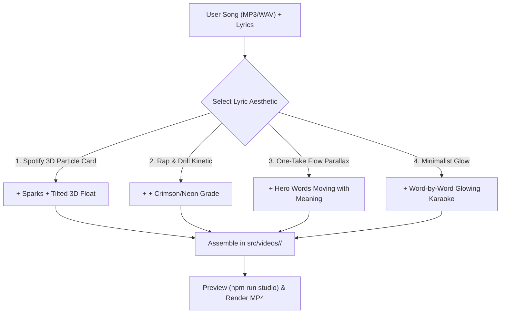

# CineFlow Lyrics & Music Video Production Engine

Inspired by the top viral styles on *aansh.ai/skills* (Spotify particle cards, rap & drill kinetic text, one-take flow lyrics, and glowing aesthetic lyric videos), this skill enables CineFlow to transform any song and lyrics into a viral, studio-grade lyric video.

---

## 1. Supported Lyric Video Aesthetics



| Aesthetic | Vibe & Key Visuals | Core Primitives |
| :--- | :--- | :--- |
| **Spotify 3D Lyric Card** (`/spotify-particle-lyrics`) | Tilted 3D glass card with album cover art, song title, artist name, and sung lines lighting up with glowing sparks on the beat. | `<SpotifyLyricCard>`, `<Audio>`, `<Background>` |
| **Rap & Drill Kinetic** (`/red-rap-lyrics`) | Dark crimson or cyber neon color grade, drifting 3D background wall of words, intense 808 bass kick camera shakes, and DAMN! slams. | `<WordWall3D>`, `<BeatCameraShake>`, `<KeywordCallout>` |
| **One-Take Flow & Parallax** (`/one-take-forest-lyrics`) | Seamless continuous camera glide through a 3D environment with hero words that move with their meaning (rising, burning, glowing). | `<OneTakeCamera>`, `<Card3D>`, `<Kinetic>` |
| **Minimalist Aesthetic Glow** (`/glow-lyrics`) | Elegant typography, soft neon aura, and a glassmorphic music player HUD at the bottom. | `<MusicPlayerHUD>`, `<AudioWaveform>` |

---

## 2. Pre-Built Lyric Primitives (`src/lyrics.tsx`)

Import directly from `../../lyrics`:

```tsx
import {
  SpotifyLyricCard,
  WordWall3D,
  BeatCameraShake,
  MusicPlayerHUD,
} from '../../lyrics';
```

---

## 3. Step-by-Step Production Recipe

### Step 1: Place Song & Prepare Lyrics
1. Place the song file in `public/` (e.g. `public/song.mp3`).
2. If available, place cover art in `public/cover.jpg`.
3. Inspect the song length using the metadata inspector:
   ```bash
   node scripts/inspect-video.mjs "public/song.mp3"
   ```
4. Prepare timestamped lyric lines in frames ($30 \text{ frames} = 1 \text{ second}$):
   ```ts
   const lyrics = [
     {startFrame: 0, endFrame: 90, text: "Lost in the neon lights tonight"},
     {startFrame: 90, endFrame: 180, text: "Chasing the shadows out of sight"},
     {startFrame: 180, endFrame: 270, text: "Can you hear the bassline drop?"},
   ];
   ```

---

### Step 2: Implement Composition (`src/videos/<song-name>/index.tsx`)

#### Example: Spotify 3D Particle Lyric Video
```tsx
import React from 'react';
import {AbsoluteFill, Audio, staticFile} from 'remotion';
import {Background, C, FONT} from '../../ui';
import {SpotifyLyricCard} from '../../lyrics';

export const LYRICS_CONFIG = {
  id: 'NeonNightsLyrics',
  fps: 30,
  durationInFrames: 30 * 60, // 60 seconds
  width: 1920,
  height: 1080,
};

const lines = [
  {startFrame: 30, endFrame: 120, text: "Take me back to where we started"},
  {startFrame: 120, endFrame: 210, text: "Before the promises were broken"},
  {startFrame: 210, endFrame: 300, text: "Running through the midnight rain"},
];

export const NeonNightsLyrics: React.FC = () => {
  return (
    <AbsoluteFill style={{backgroundColor: C.bg, fontFamily: FONT}}>
      <Background />
      <SpotifyLyricCard
        trackTitle="Neon Nights"
        artistName="CineFlow Artist"
        coverImage="cover.jpg"
        accentColor="#1ED760"
        lines={lines}
      />
      <Audio src={staticFile('song.mp3')} />
    </AbsoluteFill>
  );
};
```

---

### Step 3: Register & Render
1. Register in `src/videos/index.tsx`.
2. Check types: `npx tsc --noEmit`.
3. Preview in studio: `npm run studio`.
4. Render MP4:
   ```bash
   npx remotion render src/index.ts NeonNightsLyrics out/neon-nights.mp4
   ```

---

## 4. How Users Prompt CineFlow for Lyric Videos

Users can prompt in simple, natural language:

> *"Here is `public/song.mp3` with cover art `public/cover.jpg`. Create a 16:9 Spotify 3D particle lyric video where the card floats in 3D, and the words light up in electric green as they are sung."*

> *"Make a high-energy 9:16 vertical rap lyric video for `public/track.mp3`. Use a dark red aesthetic, a drifting 3D word wall in the background, and camera shake on every bass drop."*
