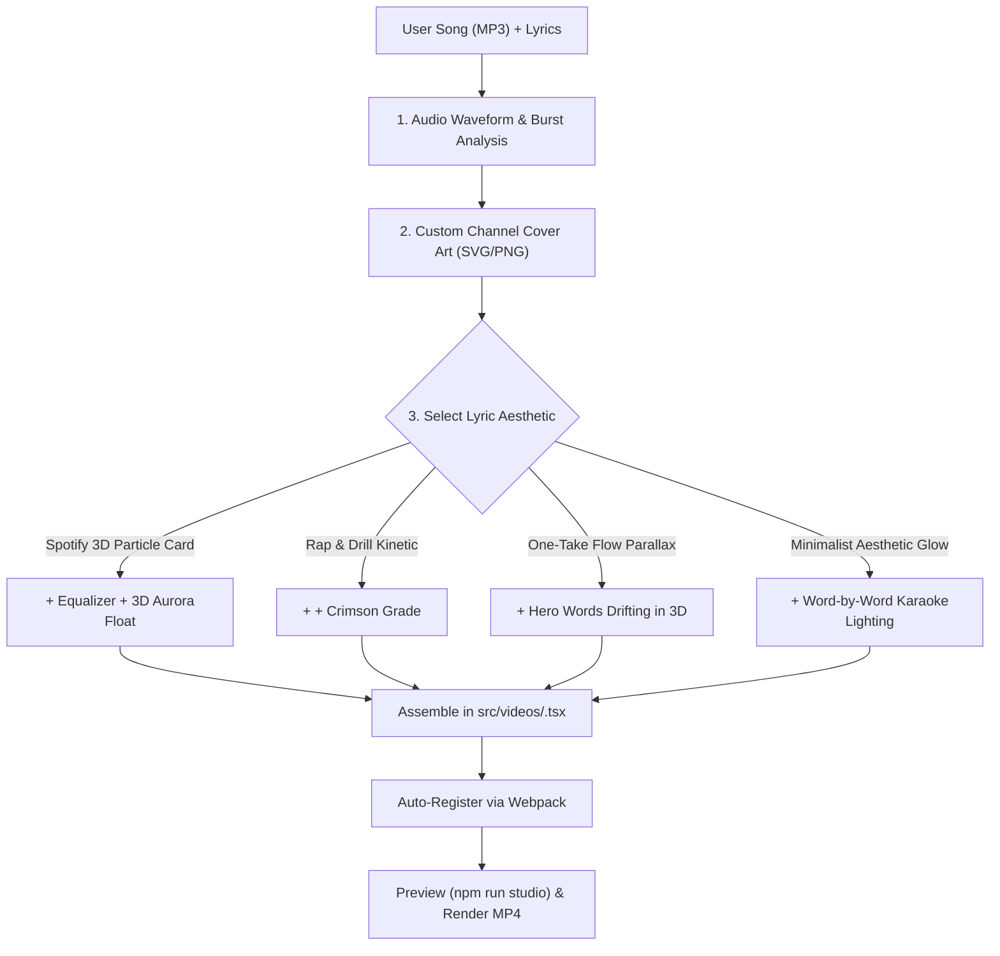

# CineFlow Lyrics & Music Video Production Engine

CineFlow provides an autonomous engine to convert any user song and lyrics into a broadcast-grade music video. It analyzes audio bursts, computes frame-accurate word timestamps, incorporates custom artist/channel branding (e.g. YouTube channels like **"Musical Riad"**), and renders 3D music players.

---

## 🛑 Guardrails & Architecture Standards
1. **Zero Core Edits:** Never modify `src/lyrics.tsx`, `src/ui.tsx`, or `src/videos/index.tsx`.
2. **Single-File Isolation:** The entire lyric video must live in `src/videos/<song-name>.tsx`.
3. **Channel Branding:** Read `user-project.json` for the user's YouTube channel name, verified status, and brand colors.
4. **User Assets:** Audio files and custom cover SVGs/art reside in `public/`.

---

## 1. Supported Lyric Video Aesthetics



---

## 2. Autonomous Audio & Lyric Sync Recipe

When a user provides an MP3 and lyrics:

### Step 1: Inspect Audio Length & Dynamics
```bash
node scripts/inspect-video.mjs "public/<song-file>.mp3"
```
Determine the total duration in seconds and calculate `durationInFrames = Math.round(seconds * 30)`.

### Step 2: Vocal Burst & Word-Level Timestamping
Map each line and word to exact frame intervals ($30\text{ frames} = 1\text{ second}$):
```typescript
interface LyricWord {
  text: string;
  startFrame: number;
  endFrame: number;
}

interface LyricLine {
  startFrame: number;
  endFrame: number;
  text: string;
  translation?: string; // Poetic English translation
  words?: LyricWord[]; // Word-by-word karaoke timestamps
}
```

### Step 3: Custom Cover Art Generation
If the user specifies a channel name (e.g. **"Musical Riad"**), generate a dedicated SVG cover in `public/cover-<project>.svg` featuring:
- Vinyl record grooves and glowing core
- Track title and artist name
- User's YouTube channel badge (e.g. `▶ MUSICAL RIAD • OFFICIAL`)

### Step 4: Write Self-Contained Video (`src/videos/<song-name>.tsx`)
```tsx
import React from 'react';
import { AbsoluteFill, Audio, staticFile, useCurrentFrame } from 'remotion';
import { EditorProgressBar } from '../editor';
import { LyricLine, SpotifyLyricCard, WordWall3D, FONT_OUTFIT, FONT_PLUS_JAKARTA } from '../lyrics';
import { C } from '../ui';

export const config = {
  id: 'SongTitleLyrics',
  fps: 30,
  durationInFrames: 3823,
  width: 1920,
  height: 1080,
};

export const SongTitleLyrics: React.FC = () => {
  return (
    <AbsoluteFill style={{ backgroundColor: '#07070E', fontFamily: FONT_PLUS_JAKARTA }}>
      {/* 1. Original User Song Track */}
      <Audio src={staticFile('song.mp3')} volume={1} />

      {/* 2. Dynamic Cosmic Aurora Backdrop & 52-Bar Audio Spectrum */}
      <AmbientBackdrop />

      {/* 3. Top Progress Bar */}
      <EditorProgressBar position="top" height={4} color="#1ED760" />

      {/* 4. Center 3D Floating Player Card */}
      <AbsoluteFill style={{ display: 'flex', alignItems: 'center', justifyContent: 'center' }}>
        <SpotifyLyricCard
          lines={lyrics}
          trackTitle="Song Title"
          artistName="Artist Name"
          channelName="Musical Riad"
          verified={true}
          coverImage="cover-song.svg"
          accentColor="#1ED760"
          width={880}
          height={940}
        />
      </AbsoluteFill>
    </AbsoluteFill>
  );
};
```

---

## 3. Verification & Delivery

1. Run `npm run typecheck` (`node scripts/sync-videos.mjs && tsc --noEmit`).
2. Update `user-project.json` active project info.
3. Deliver studio and render commands:
   - Preview: `npm run studio`
   - Render: `npx remotion render src/index.ts <CompositionId> out/<song-name>.mp4`
