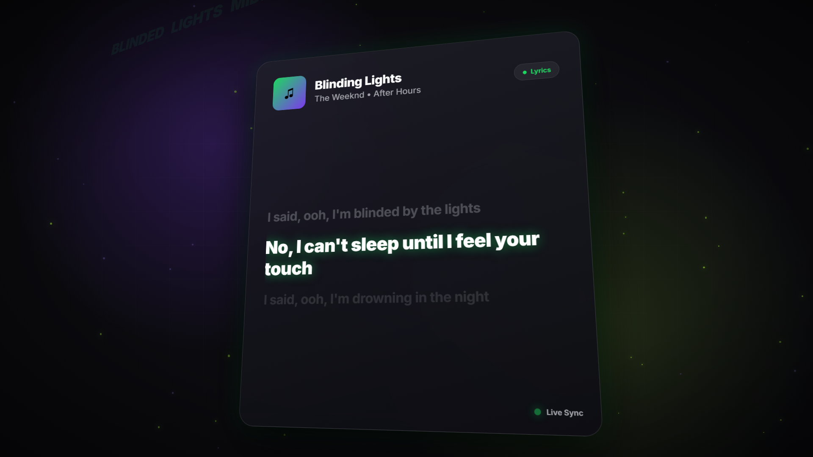
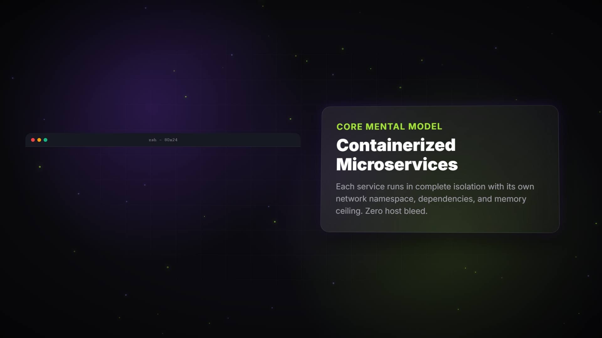

# 🎬 CineFlow

> **Autonomous AI Video Production Studio & Programmatic Video Editor**  
> Powered by [Remotion](https://remotion.dev), React 18, TypeScript & AI Agent Skills.

[](https://remotion.dev)
[](https://react.dev)
[](https://www.typescriptlang.org)
[](LICENSE)

Clone this repository, place your media in `public/`, and paste a ready-made prompt to your AI coding agent (Antigravity, Cursor, Claude Code, Codex). **CineFlow** autonomously plans, animates, edits, and renders broadcast-quality videos.

---

## ⚡ Quick Start

```bash
git clone https://github.com/your-username/cineflow.git
cd cineflow
npm install
```

```bash
# Launch interactive browser studio
npm run studio
```

---

## 📁 Where to Put Your Files

Place all your raw assets inside the `public/` folder so CineFlow can access them:

| Asset Type | Recommended Path | Supported Formats |
| :--- | :--- | :--- |
| **Songs / Audio** | `public/song.mp3` | `.mp3`, `.wav`, `.m4a`, `.aac` |
| **Album / Cover Art** | `public/cover.jpg` | `.jpg`, `.png`, `.webp` |
| **Raw Video Footage** | `public/my-clip.mp4` | `.mp4`, `.mov`, `.webm` |
| **Screenshots / UI** | `public/app-screen.png` | `.png`, `.jpg`, `.webp` |

---

## 🎯 Ready-Made Prompts & Previews

---

### 1. 🎵 Spotify 3D Particle Lyric Video
Transform any song into a viral 3D floating Spotify lyrics card with glowing sparks synced to the vocals (inspired by [aansh.ai](https://aanshai.vercel.app/skills)).



#### 📋 Ready-to-Copy Prompt:
```text
I placed my song at public/song.mp3 and album cover at public/cover.jpg.
Create a 16:9 Spotify 3D particle lyric video for this track.
The card should float with gentle 3D perspective tilt, the song info and cover art should be at the top, and sung lyric lines should light up in electric green with glowing sparks as the singer vocalizes. Behind the card, add a subtle 3D drifting wall of lyric keywords.
```

---

### 2. ✂️ Professional Talking-Head Video Editing
Turn a raw recording into a polished, high-retention video like a top-tier YouTube editor (cuts silences, punch-in zooms, broadcast lower-thirds, auto-ducking music).


#### 📋 Ready-to-Copy Prompt:
```text
I placed my raw video at public/my-clip.mp4.
Edit it like an elite professional video editor:
1. Inspect the duration and cut out any dead air or long pauses.
2. Add punch-in zooms (1.25x) on key punchlines to keep visual pacing active.
3. Add a sleek animated lower-third with my name and title in the first 5 seconds.
4. When I mention software, display public/app-screen.png inside a modern macOS dark-mode window frame.
5. Add background music with automated ducking (music drops to 12% while I speak and swells during pauses).
```

---

### 3. 🎓 Technical & Code Explainer (Explainroo / OneTake Style)
Teach technical architectures, developer tools, or concepts using an animated macOS terminal, 3D perspective cards, and continuous camera flow.



#### 📋 Ready-to-Copy Prompt:
```text
Create a 30-second technical explainer video teaching "How Docker Containers Work".
Use the macOS animated terminal to type CLI commands line-by-line with a blinking cursor, display container architecture using 3D perspective cards with gyroscope tilt, and show an active audio waveform visualizer at the bottom.
```

---

### 4. 📱 9:16 Viral Shorts & Instagram Reels
High-retention vertical video engineered for TikTok, Reels, and YouTube Shorts with safe-zone protection and animated progress bars.

<p align="center">
  
</p>

#### 📋 Ready-to-Copy Prompt:
```text
Create a 15-second vertical (9:16) YouTube Short with "3 Pro Tips for Python Developers".
Follow strict social retention rules: deliver a punchy headline hook in the first 2 seconds, keep all core text within the mobile safe zone, add an animated green progress bar at the top, and cycle through 3 glassmorphic tip cards.
```

---

### 5. 🚀 SaaS & Product Motion Graphics Promo
Zero footage required. Generate a studio-grade kinetic motion graphics commercial from text.


#### 📋 Ready-to-Copy Prompt:
```text
Create a 20-second high-energy product launch promo video for my new developer platform called "FastDeploy".
Use an obsidian dark canvas (#0B0B0F), electric lime (#A3E635) and soft violet (#A78BFA) gradients, kinetic spring-bouncy typography, glowing floating particles, and tech badge tiles.
```

---

## 🎛️ Essential Commands

```bash
# 1. Preview videos in the live browser player
npm run studio

# 2. Inspect any video or song metadata (duration, FPS, resolution)
npm run inspect -- public/my-clip.mp4

# 3. List all registered compositions
npm run compositions

# 4. Render final production MP4
npx remotion render src/index.ts <CompositionId> out/<output-filename>.mp4
```

---

## 📂 Architecture & Skills Suite

```text
cineflow/
├── .agents/skills/             # Autonomous AI Agent Skills
│   ├── SKILL.md                # 🧠 Master Router & Orchestrator
│   ├── lyrics/                 # Spotify 3D cards, rap word walls, beat shake
│   ├── editor/                 # Post-production, cuts, zoom, lower-thirds, captions
│   ├── creator/                # Motion graphics from scratch & scene sequencing
│   ├── explainers/             # Technical explainers, terminal typing, 3D camera
│   ├── shorts/                 # 9:16 vertical shorts, reels & TikToks
│   ├── design/                 # Spring physics (POP/SMOOTH), glassmorphism, easing
│   ├── audio/                  # Audio ducking curves, sound effects (SFX), BPM sync
│   └── renderer/               # Multi-threaded CLI rendering & export tuning
├── src/
│   ├── videos/                 # Generated & edited video projects
│   │   ├── index.tsx           # Central composition registry
│   │   └── <project-name>/     # Isolated video modules (index.tsx, scenes.tsx)
│   ├── lyrics.tsx              # Spotify card, word wall & music player HUD kit
│   ├── editor.tsx              # Editing & explainer primitives kit
│   ├── ui.tsx                  # Shared motion design & animation kit
│   ├── Root.tsx                # Remotion root registry
│   └── index.ts                # Application entry point
├── scripts/
│   ├── inspect-video.mjs       # Automated video metadata extractor
│   └── assets.mjs              # Asset detector
├── docs/images/                # Visual preview screenshots
└── public/                     # Input media, audio, images & static assets
```

---

## 📜 License

[MIT License](LICENSE) — Free to use, fork, and build videos with AI!
