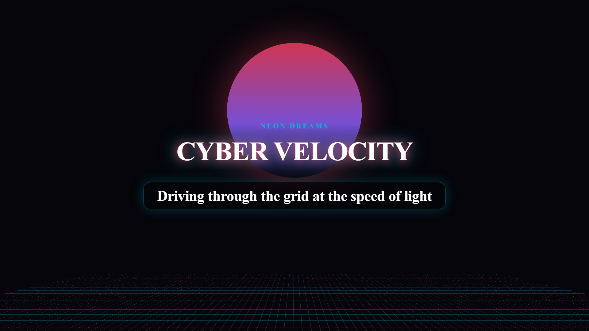

# 🎬 CineFlow — Autonomous AI Video Production Studio

> **The Public Open-Source AI Video Engine powered by [Remotion](https://remotion.dev), React 18, TypeScript & AI Agent Skills.**  
> Create broadcast-grade motion graphics, edit footage, and generate beat-synced lyric videos autonomously from simple natural language prompts.

[](https://remotion.dev)
[](https://react.dev)
[](https://www.typescriptlang.org)
[](LICENSE)
[](#-critical-architecture-rules--guardrails)

---

## 🛑 CRITICAL ARCHITECTURE RULES & GUARDRAILS

To ensure 100% bug-free video production with **zero contamination to the core GitHub repository**, every user and AI coding agent (**Antigravity, Cursor, Claude Code, Codex, Copilot**) MUST strictly follow these rules:

```
┌─────────────────────────────────────────────────────────────────────────────┐
│                 🔒 IMMUTABLE CORE FRAMEWORK (NEVER TOUCH / READ-ONLY)       │
│  src/ui.tsx  •  src/editor.tsx  •  src/lyrics.tsx  •  src/videos/index.tsx   │
│  src/Root.tsx  •  src/index.ts  •  scripts/*  •  package.json               │
└──────────────────────────────────────┬──────────────────────────────────────┘
                                       │ (Read-Only Imports)
                                       ▼
┌─────────────────────────────────────────────────────────────────────────────┐
│                  ✨ USER WORKSPACE (ALL USER & AI CREATIONS LIVE HERE)       │
│  1. Root User Manifest : user-project.json (Channel name, brand colors)     │
│  2. User Video Projects: src/videos/<video-name>.tsx (100% self-contained) │
│  3. User Media Assets  : public/<asset-name> (Input MP3s, clips, SVGs)      │
└─────────────────────────────────────────────────────────────────────────────┘
```

### 1. 🔒 Protected Core Engine Files (DO NOT MODIFY)
Under NO circumstances should any AI or user edit or modify these files:
- **`src/ui.tsx`** — Core Motion Graphics engine (spring physics, typography, backgrounds, color tokens).
- **`src/editor.tsx`** — Core Video Editing engine (video trimming, 9:16 re-framing, captioning, zoom).
- **`src/lyrics.tsx`** — Core Music Video engine (Spotify 3D cards, word walls, vinyl player, neon horizon).
- **`src/videos/index.tsx`** — Dynamic auto-discovery engine. It uses Webpack `require.context` to automatically detect videos in `src/videos/`. Never edit this file!
- **`src/Root.tsx` & `src/index.ts`** — Remotion entrypoint.
- **`package.json` & `tsconfig.json`** — Core dependencies and TypeScript config.

### 2. ✨ Allowed User Workspaces (WHERE YOU OPERATE)
All user projects, AI-generated videos, and edits MUST reside strictly in these locations:
- **`user-project.json` (Root Directory):**  
  Stores your channel identity (e.g. YouTube channel name, verified artist badge), brand colors, and active video metadata.
- **`src/videos/<video-name>.tsx`:**  
  Every video project is 100% self-contained in its own file (or `src/videos/<video-name>/index.tsx`). If you delete this file, the video is instantly erased without leaving broken references in the repository.
- **`public/`:**  
  Place your input media (songs `.mp3`, raw video clips `.mp4`, custom album art `.svg` / `.png`).

---

## ⚡ Quick Start

### 1. Clone & Install
```bash
git clone https://github.com/your-username/cineflow.git
cd cineflow
npm install
```

### 2. Launch Interactive Studio Player
```bash
npm run studio
```
Open [http://localhost:3000](http://localhost:3000) in your browser. You will see the live interactive timeline player.

---

## 🎬 The 3 Autonomous AI Video Workflows

Simply prompt your AI coding agent (Antigravity, Cursor, Claude Code) with what you want:

### 🅰️ Workflow 1: Generate New Motion Graphics From Prompt
*Prompt example:* `"Make a 20s promo video for my new developer SaaS called QuickCloud."`
- The AI creates a single self-contained file: `src/videos/quickcloud-promo.tsx`.
- The AI selects aesthetic visual styles (glassmorphism cards, glowing neons, kinetic typography).
- The AI applies unique, scene-adaptive dynamic backgrounds (never repeating the same background).
- The AI synchronizes animation sound effects (`whoosh.wav`, `pop.wav`, `impact.wav`, `click.wav`, `chime.wav`).
- Webpack discovers it automatically—no manual imports needed!

### 🅱️ Workflow 2: Autonomous Video Editing & Post-Production
*Prompt example:* `"I placed my raw clip at public/interview.mp4. Edit it: trim dead air, reframe to 9:16 vertical, add word-by-word karaoke subtitles, and punch-in zooms."`
- The AI inspects metadata using `node scripts/inspect-video.mjs "public/interview.mp4"`.
- The AI writes `src/videos/interview-vertical-edit.tsx` using `<VideoClip>`, `<ReframeVertical>`, `<CaptionOverlay>`, `<PunchZoom>`, and `<LowerThird>`.
- Background music automatically ducks when voiceover is detected.

### 🅲️ Workflow 3: Music & Lyric Video Production
*Prompt example:* `"I placed my song at public/song.mp3. Create a 16:9 Spotify 3D floating particle lyric video for my YouTube channel Musical Riad."`
- The AI analyzes audio duration, rhythm, vocal energy peaks, and word bursts.
- The AI generates millisecond-accurate word timestamps (`words: LyricWord[]`).
- The AI generates custom channel album artwork (e.g. `public/cover-musical-riad.svg`) and embeds your YouTube verified badge.
- Sung lyric words light up in electric green with glowing sparks as the singer vocalizes.

---

## 📁 Where to Put Your Assets

Drop your media files into the `public/` directory:

| Asset | Location | Supported Formats |
| :--- | :--- | :--- |
| **Songs / Audio** | `public/<song-name>.mp3` | `.mp3`, `.wav`, `.m4a`, `.aac` |
| **Album Art / Covers** | `public/<cover-name>.svg` | `.svg`, `.png`, `.jpg`, `.webp` |
| **Raw Video Clips** | `public/<video-name>.mp4` | `.mp4`, `.mov`, `.webm` |
| **Screenshots / Images** | `public/<image-name>.png` | `.png`, `.jpg`, `.webp` |

---

## 🎵 Music & Lyric Video Styles (Ready-to-Copy Prompts)

### 1. Spotify 3D Floating Lyric Card
Floating 3D glass card with album cover art, track info, and live singing lines lighting up with glowing green sparks on beat.


#### 📋 Ready Prompt:
```text
I placed my song at public/song.mp3.
Create a 16:9 Spotify 3D particle lyric video.
The card should float with smooth 3D perspective tilt, the cover art and title should sit at the top, and sung lyric lines should light up in electric green with glowing sparks as the singer vocalizes. Behind the card, add a subtle 3D drifting wall of lyric keywords and a 52-bar real-time audio spectrum.
```

---

### 2. Aggressive Rap & Drill Kinetic Word Wall
Dark crimson aesthetic with a massive drifting 3D background lyric wall, 808 bass kick camera shakes, and punchy impact typography.


#### 📋 Ready Prompt:
```text
I placed my rap track at public/song.mp3.
Create a high-energy rap kinetic lyric video.
Use an intense dark red/black aesthetic (#0A0002) with a massive 3D lyric word wall drifting in the background, camera kick-shakes on every 808 bass drop, and bold skewed italic lyric lines that slam on screen.
```

---

### 3. Cyberpunk Synthwave & EDM Neon Horizon
Retro 80s neon horizon grid scrolling into the distance with a glowing synth sun and vibrant cyan/magenta audio-reactive lyrics.



#### 📋 Ready Prompt:
```text
I placed my track at public/song.mp3.
Create an electronic synthwave neon lyric video.
Add a scrolling 3D perspective grid horizon at the bottom, a glowing retro sun in the center, and cyan (#06B6D4) and magenta (#F43F5E) glowing typography synced to the beat.
```

---

### 4. Cozy Lo-Fi Vinyl Player
Spinning 33 RPM vinyl record with concentric grooves, warm ambient lighting, and delicate italic lyrics for acoustic, indie, or chillhop music.


#### 📋 Ready Prompt:
```text
I placed my track at public/song.mp3.
Create a chill lo-fi vinyl lyric video.
Render an authentic spinning vinyl record player on the left with center label art, warm amber lighting (#F59E0B), and floating lyric cards with elegant quotes on the right.
```

---

## 🎬 Video Editing & Explainer Prompts

### 5. Professional Talking-Head Video Editing
Cuts dead air, adds punch-in zooms on key statements, overlays broadcast lower-thirds, and applies automated music ducking.


#### 📋 Ready Prompt:
```text
I placed my raw video at public/my-clip.mp4.
Edit it like an elite professional video editor:
1. Cut out any dead air or long pauses.
2. Add punch-in zooms (1.25x) on key punchlines to keep visual pacing active.
3. Add a sleek animated lower-third with my name and title in the first 5 seconds.
4. When I mention software, display public/app-screen.png inside a modern macOS window frame.
5. Add background music with automated ducking (music drops to 12% while I speak).
```

---

### 6. Technical & Code Explainer
Animated macOS terminal typing CLI commands line-by-line with 3D perspective cards and continuous camera flow.


#### 📋 Ready Prompt:
```text
Create a 30-second technical explainer video teaching "How Docker Containers Work".
Use the macOS animated terminal to type CLI commands line-by-line with a blinking cursor, display container architecture using 3D perspective cards with gyroscope tilt, and show an active audio waveform visualizer at the bottom.
```

---

### 7. 9:16 Viral Shorts & Instagram Reels
Engineered for TikTok, Instagram Reels, and YouTube Shorts with safe-zone protection and animated progress bars.

<p align="center">
  
</p>

#### 📋 Ready Prompt:
```text
Create a 15-second vertical (9:16) YouTube Short with "3 Pro Tips for Python Developers".
Follow strict social retention rules: deliver a punchy headline hook in the first 2 seconds, keep all core text within the mobile safe zone, add an animated green progress bar at the top, and cycle through 3 glassmorphic tip cards.
```

---

### 8. SaaS & Product Motion Graphics Commercial
Zero footage needed. Turn text into a high-energy kinetic commercial.


#### 📋 Ready Prompt:
```text
Create a 20-second high-energy product launch promo video for my new developer platform called "FastDeploy".
Use an obsidian dark canvas (#0B0B0F), electric lime (#A3E635) and soft violet (#A78BFA) gradients, kinetic spring-bouncy typography, glowing floating particles, and tech badge tiles.
```

---

## 🎛️ How to Preview, Inspect & Render Videos

### 1. Live Browser Studio Preview
```bash
npm run studio
```
Opens Remotion Studio at `http://localhost:3000`. You can scrub through the timeline frame-by-frame, test audio, and inspect animations.

### 2. TypeScript Verification (Pre-Flight Check)
```bash
npm run typecheck
```
Scans `src/videos/` and validates all video compositions without type errors.

### 3. Inspect Media Metadata
```bash
npm run inspect -- public/my-song.mp3
# or
npm run inspect -- public/raw-video.mp4
```
Outputs duration, exact frames at 30 fps, resolution, and audio channels.

### 4. Render Final Video to MP4
```bash
# Render by Composition ID:
npx remotion render src/index.ts <CompositionId> out/<video-name>.mp4

# Example:
npx remotion render src/index.ts MyPromoVideo out/promo.mp4
```

### 5. Render High-Performance / Multi-Threaded
```bash
# Render with maximum concurrency and GPU acceleration:
npx remotion render src/index.ts <CompositionId> out/video.mp4 --concurrency=8 --gl=angle
```

### 6. Export Still Thumbnail Frame
```bash
npx remotion still src/index.ts <CompositionId> out/thumbnail.png --frame=600
```

---

## 📂 Complete Repository Architecture

```text
motion-animation/
├── user-project.json           # 📋 Root User Profile (Channel branding, active video meta)
├── AGENTS.md                   # 📜 Master AI Agent Operating Rules & Guardrails
├── README.md                   # 📖 Full Framework Documentation
│
├── .agents/skills/             # 🧠 Autonomous AI Director & Specialized Skills
│   ├── director/               # Master orchestrator & skill selector
│   ├── creator/                # Prompt-to-video generator (promos, SaaS)
│   ├── editor/                 # Post-production, cuts, zoom, subtitles, PiP
│   ├── lyrics/                 # 3D Spotify cards, rap word walls, vinyl, neon
│   ├── shorts/                 # 9:16 vertical retention shorts & reels
│   ├── explainers/             # Technical tutorials, terminal typing, 3D cards
│   ├── audio/                  # Dynamic sound design, SFX, audio ducking
│   ├── design/                 # Easing curves, glassmorphism, design tokens
│   └── renderer/               # CLI export optimization & troubleshooting
│
├── public/                     # 📂 User Input Media (Songs, clips, covers)
│   └── sfx/                    # 🔊 Built-in animation SFX (whoosh, pop, impact, click, chime)
│
├── scripts/                    # ⚙️ Helper Scripts
│   ├── sync-videos.mjs         # Auto-discovery script for video compositions
│   ├── inspect-video.mjs       # Media metadata analyzer (duration, FPS)
│   └── generate-sfx.mjs        # Algorithmic audio synthesis
│
└── src/                        # 💻 Application Source Code
    ├── ui.tsx                  # 🔒 Core Motion Design Kit (READ-ONLY)
    ├── editor.tsx              # 🔒 Core Video Editing Kit (READ-ONLY)
    ├── lyrics.tsx              # 🔒 Core Music Video Kit (READ-ONLY)
    ├── Root.tsx                # 🔒 Remotion Root (READ-ONLY)
    ├── index.ts                # 🔒 App Entrypoint (READ-ONLY)
    └── videos/                 # ✨ USER VIDEO WORKSPACE (AI operates here)
        ├── index.tsx           # 🔒 Dynamic Webpack Registry (READ-ONLY)
        ├── EmptyPlaceholder.tsx# Welcome screen when no user videos exist
        └── <video-name>.tsx    # Your 100% self-contained video project
```

---

## 📜 License

[MIT License](LICENSE) — Free to use, fork, and build videos with AI!
