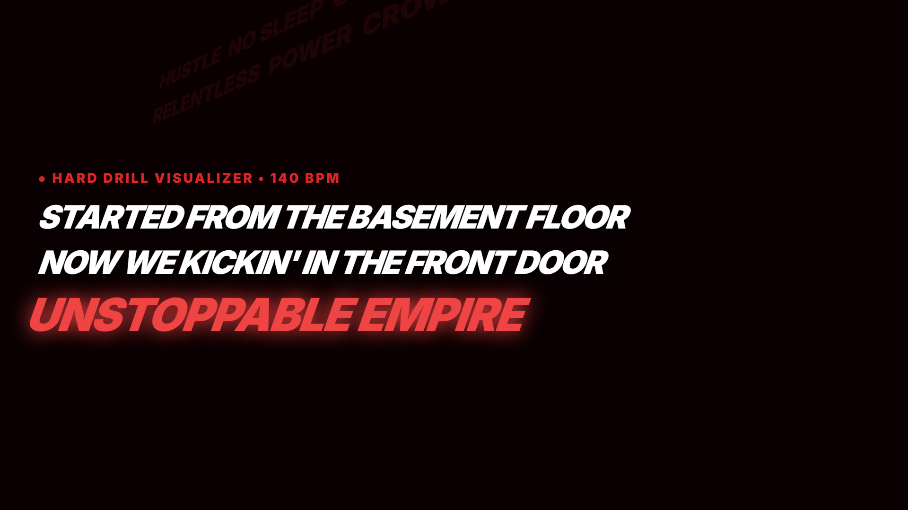
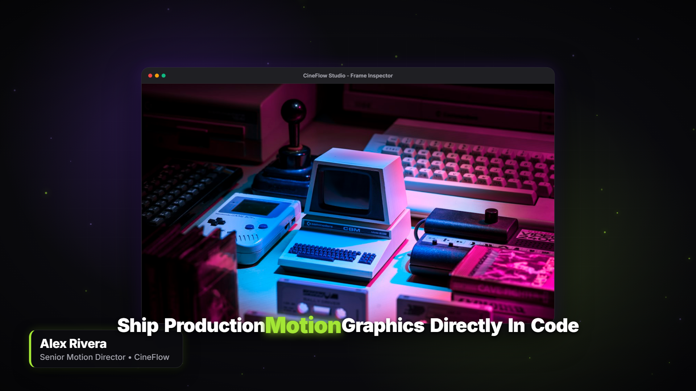
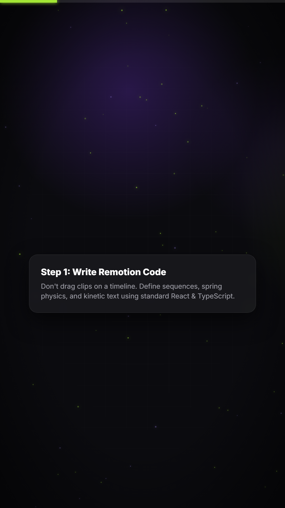

# 🎬 CineFlow

> **Autonomous AI Video Production Studio & Programmatic Video Editor**  
> Powered by [Remotion](https://remotion.dev), React 18, TypeScript & AI Agent Skills.

[](https://remotion.dev)
[](https://react.dev)
[](https://www.typescriptlang.org)
[](LICENSE)

Clone this repository, place your assets in `public/`, and paste any ready-made prompt to your AI coding agent (Antigravity, Cursor, Claude Code, Codex). **CineFlow** autonomously plans, animates, edits, and renders broadcast-grade videos.

---

## ⚡ Quick Start

```bash
git clone https://github.com/your-username/cineflow.git
cd cineflow
npm install
```

```bash
# Launch interactive browser studio player
npm run studio
```

---

## 📁 Where to Put Your Assets

Drop your media files into the `public/` directory so CineFlow can load them:

| Asset | File Location | Accepted Formats |
| :--- | :--- | :--- |
| **Songs / Music** | `public/song.mp3` | `.mp3`, `.wav`, `.m4a`, `.aac` |
| **Album Art / Cover** | `public/cover.jpg` | `.jpg`, `.png`, `.webp` |
| **Raw Video Footage** | `public/my-clip.mp4` | `.mp4`, `.mov`, `.webm` |
| **Screenshots / Graphics** | `public/app-screen.png` | `.png`, `.jpg`, `.webp` |

---

## 🎵 Music & Lyric Video Styles (Ready-Made Prompts)

CineFlow includes native multi-style music engines tailored for any genre:

---

### 1. Spotify 3D Floating Lyric Card
Floating 3D glass card with album cover art, track info, and live singing lines lighting up with glowing green sparks on beat.


#### 📋 Ready-to-Copy Prompt:
```text
I placed my song at public/song.mp3 and album cover at public/cover.jpg.
Create a 16:9 Spotify 3D particle lyric video.
The card should float with smooth 3D perspective tilt, the cover art and title should sit at the top, and sung lyric lines should light up in electric green with glowing sparks as the singer vocalizes. Behind the card, add a subtle 3D drifting wall of lyric keywords.
```

---

### 2. Aggressive Rap & Drill Kinetic Word Wall
Dark crimson aesthetic with a massive drifting 3D background lyric wall, 808 bass kick camera shakes, and punchy impact typography.



#### 📋 Ready-to-Copy Prompt:
```text
I placed my rap track at public/song.mp3.
Create a high-energy rap kinetic lyric video.
Use an intense dark red/black aesthetic (#0A0002) with a massive 3D lyric word wall drifting in the background, camera kick-shakes on every 808 bass drop, and bold skewed italic lyric lines that slam on screen.
```

---

### 3. Cyberpunk Synthwave & EDM Neon Horizon
Retro 80s neon horizon grid scrolling into the distance with a glowing synth sun and vibrant cyan/magenta audio-reactive lyrics.


#### 📋 Ready-to-Copy Prompt:
```text
I placed my track at public/song.mp3.
Create an electronic synthwave neon lyric video.
Add a scrolling 3D perspective grid horizon at the bottom, a glowing retro sun in the center, and cyan (#06B6D4) and magenta (#F43F5E) glowing typography synced to the beat.
```

---

### 4. Cozy Lo-Fi Vinyl Player
Spinning 33 RPM vinyl record with concentric grooves, warm ambient lighting, and delicate italic lyrics for acoustic, indie, or chillhop music.


#### 📋 Ready-to-Copy Prompt:
```text
I placed my track at public/song.mp3.
Create a chill lo-fi vinyl lyric video.
Render an authentic spinning vinyl record player on the left with center label art, warm amber lighting (#F59E0B), and floating lyric cards with elegant quotes on the right.
```

---

## 🎬 Video Editing, Explainers & Motion Graphics

---

### 5. Professional Talking-Head Video Editing
Cuts dead air, adds punch-in zooms on key statements, overlays broadcast lower-thirds, and applies automated music ducking.



#### 📋 Ready-to-Copy Prompt:
```text
I placed my raw video at public/my-clip.mp4.
Edit it like an elite professional video editor:
1. Cut out any dead air or long pauses.
2. Add punch-in zooms (1.25x) on key punchlines to keep visual pacing active.
3. Add a sleek animated lower-third with my name and title in the first 5 seconds.
4. When I mention software, display public/app-screen.png inside a modern macOS window frame.
5. Add background music with automated ducking (music drops to 12% while I speak).
```

---

### 6. Technical & Code Explainer
Animated macOS terminal typing CLI commands line-by-line with 3D perspective cards and continuous camera flow.


#### 📋 Ready-to-Copy Prompt:
```text
Create a 30-second technical explainer video teaching "How Docker Containers Work".
Use the macOS animated terminal to type CLI commands line-by-line with a blinking cursor, display container architecture using 3D perspective cards with gyroscope tilt, and show an active audio waveform visualizer at the bottom.
```

---

### 7. 9:16 Viral Shorts & Instagram Reels
Engineered for TikTok, Instagram Reels, and YouTube Shorts with safe-zone protection and animated progress bars.

<p align="center">
  
</p>

#### 📋 Ready-to-Copy Prompt:
```text
Create a 15-second vertical (9:16) YouTube Short with "3 Pro Tips for Python Developers".
Follow strict social retention rules: deliver a punchy headline hook in the first 2 seconds, keep all core text within the mobile safe zone, add an animated green progress bar at the top, and cycle through 3 glassmorphic tip cards.
```

---

### 8. SaaS & Product Motion Graphics Commercial
Zero footage needed. Turn text into a high-energy kinetic commercial.


#### 📋 Ready-to-Copy Prompt:
```text
Create a 20-second high-energy product launch promo video for my new developer platform called "FastDeploy".
Use an obsidian dark canvas (#0B0B0F), electric lime (#A3E635) and soft violet (#A78BFA) gradients, kinetic spring-bouncy typography, glowing floating particles, and tech badge tiles.
```

---

## 🎛️ Essential Commands

```bash
# 1. Preview videos in the live browser player
npm run studio

# 2. Inspect any video or song metadata (duration, FPS, resolution)
npm run inspect -- public/my-clip.mp4

# 3. List all available compositions
npm run compositions

# 4. Render final production MP4
npx remotion render src/index.ts <CompositionId> out/<output-filename>.mp4
```

---

## 📂 Architecture & Skills Suite

```text
cineflow/
├── .agents/skills/             # Autonomous AI Agent Skills
│   ├── SKILL.md                # 🧠 Master Router & Orchestrator
│   ├── lyrics/                 # Multi-style lyric videos (Spotify 3D, Rap, Lo-Fi, Synthwave)
│   ├── editor/                 # Post-production, cuts, zoom, lower-thirds, captions
│   ├── creator/                # Motion graphics from scratch & scene sequencing
│   ├── explainers/             # Technical explainers, terminal typing, 3D camera
│   ├── shorts/                 # 9:16 vertical shorts, reels & TikToks
│   ├── design/                 # Spring physics (POP/SMOOTH), glassmorphism, easing
│   ├── audio/                  # Audio ducking curves, sound effects (SFX), BPM sync
│   └── renderer/               # Multi-threaded CLI rendering & export tuning
├── src/
│   ├── videos/                 # Generated & edited video projects
│   │   ├── index.tsx           # Central composition registry
│   │   └── <project-name>/     # Isolated video modules (index.tsx, scenes.tsx)
│   ├── lyrics.tsx              # Spotify card, vinyl player, neon horizon & word walls
│   ├── editor.tsx              # Editing & explainer primitives kit
│   ├── ui.tsx                  # Shared motion design & animation kit
│   ├── Root.tsx                # Remotion root registry
│   └── index.ts                # Application entry point
├── scripts/
│   ├── inspect-video.mjs       # Automated video metadata extractor
│   └── assets.mjs              # Asset detector
├── docs/images/                # Visual preview screenshots
└── public/                     # Input media, audio, images & static assets
```

---

## 📜 License

[MIT License](LICENSE) — Free to use, fork, and build videos with AI!
